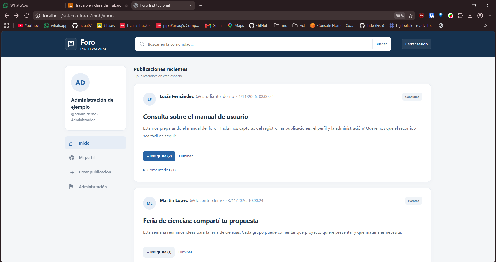
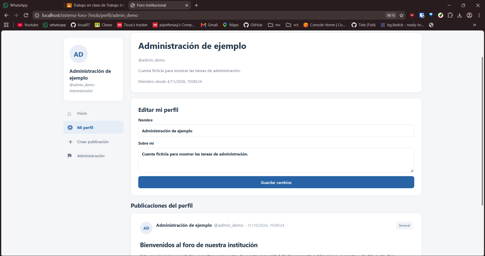
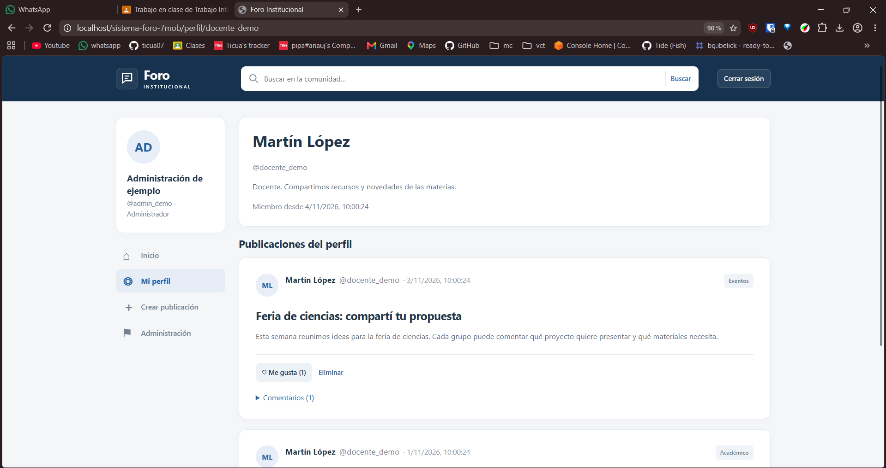
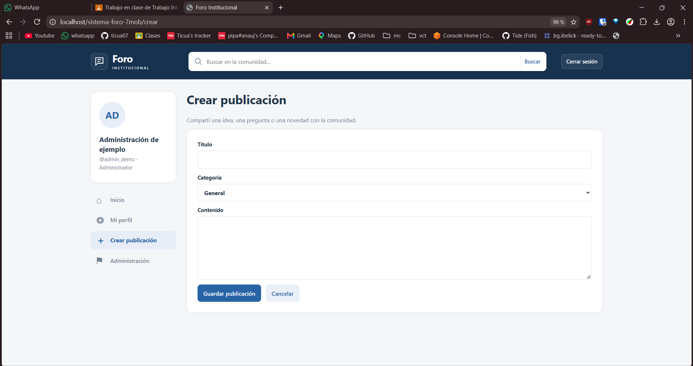
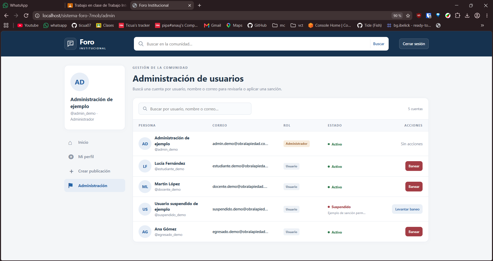

# sistema-foro-7moB

# Vistas

La página web cuenta con 4 vistas, diferenciadas en secciones.

## Inicio
Carga los posts generales, no necesita autenticación para verse.

Esta página es reutilizada cuando el usuario busca posts (`?buscar=`).

## Mi perfil/Perfil

Muestra el perfil del usuario y sus posts. Tambien muestra un formulario para editar los datos si el perfil es el mismo que el del usuario logeado.

Perfil de otra persona:

## Crear publicación

Formulario para crear una publicación.

## Administración

Pagina administración de usuarios, permite buscar y suspender o levantar suspensiones de usuarios.

Esta página solo esta disponible para administradores (Rol administrador)

# Estructura de archivos

- `frontend/`: Incluye todo el frontend con unas reglas usando .htaccess para remover el .php de las páginas para que quede mejor.
- `db/`: Incluye 3 archivos de base de datos, `foro.sql` es el archivo con solo las tablas, `foro-itlp-limpio.sql` es el archivo inicial que se usaria en la base de datos (limpio pero con categorias puestas) y `insert.sql` tiene datos falsos para probar la página web
- `backend/`: Api hecha con PHP, cada archivo es un endpoint diferente
