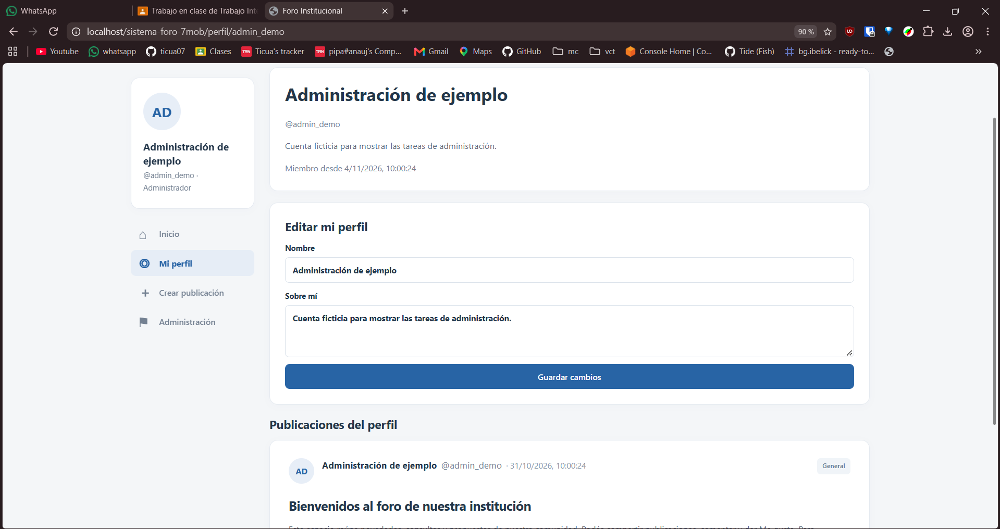
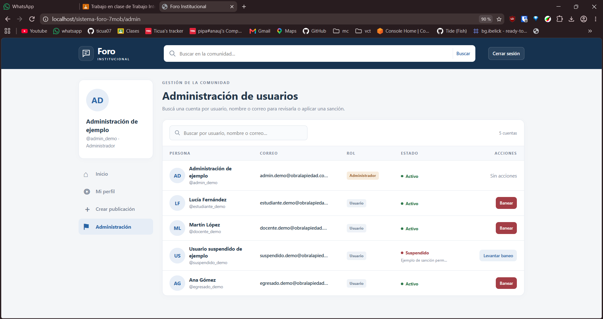

# Foro institucional 7mo B

Aplicación web de foro para una comunidad escolar. Permite compartir publicaciones, comentarlas, darles “Me gusta” y administrar cuentas y contenido.

## Contenido

- [Tecnologías y requisitos](#tecnologías-y-requisitos)
- [Estructura del proyecto](#estructura-del-proyecto)
- [Instalación con XAMPP y Apache](#instalación-con-xampp-y-apache)
- [Configuración de la conexión](#configuración-de-la-conexión)
- [Base de datos](#base-de-datos)
- [Funciones por rol](#funciones-por-rol)
- [Rutas de la aplicación](#rutas-de-la-aplicación)
- [API del backend](#api-del-backend)
- [Recuperación de contraseñas sin correo](#recuperación-de-contraseñas-sin-correo)
- [Correcciones incluidas en esta copia](#correcciones-incluidas-en-esta-copia)
- [Solución de problemas](#solución-de-problemas)
- [Capturas de pantalla](#capturas-de-pantalla)

## Tecnologías y requisitos

- PHP 8.0 o posterior.
- MySQL o MariaDB.
- Extensiones PHP `PDO`, `pdo_mysql`, `mbstring` y soporte de sesiones.
- Apache con `mod_rewrite` y `AllowOverride All` para las rutas cortas definidas en `.htaccess`.
- JavaScript moderno con módulos ES; no requiere Node.js ni un paso de compilación.

En esta computadora, la copia de demostración se ejecuta con PHP 8.2 y MariaDB 10.4.

## Estructura del proyecto

```text
.
├── .gitignore
├── .htaccess                    # Rutas cortas y página inicial de Apache
├── README.md                    # Esta documentación
├── backend/
│   ├── conn.php                 # Conexión PDO y URL pública del foro
│   ├── comun.php                # Sesión, CSRF, validaciones y funciones compartidas
│   └── *.php                    # Endpoints de la API
├── db/
│   ├── foro.sql                 # Esquema y categorías iniciales
│   ├── migracion_moderacion_y_cuentas.sql # Actualiza una base existente
│   └── insert.sql               # Datos ficticios para demostración
├── frontend/
│   ├── inicio.php               # Inicio y publicaciones
│   ├── crear.php                # Crear o editar publicaciones
│   ├── perfil.php               # Perfil y opciones de cuenta
│   ├── admin.php                # Administración y reportes
│   ├── includes/                # Encabezado y diálogos compartidos
│   ├── scripts/                 # Módulos JavaScript del frontend
│   └── estilos.css              # Estilos
└── assets/                      # Capturas usadas en esta documentación
```

Los archivos PHP del directorio `backend/` devuelven respuestas JSON y forman la API que consume el frontend.

## Instalación con XAMPP y Apache

1. Copiá la carpeta del proyecto dentro de `C:\xampp\htdocs\`, por ejemplo `C:\xampp\htdocs\sistema-foro-7moB`.
2. Iniciá Apache y MySQL desde el panel de XAMPP.
3. En `C:\xampp\apache\conf\httpd.conf`, comprobá que esté activa la línea `LoadModule rewrite_module modules/mod_rewrite.so` y que el bloque `<Directory "C:/xampp/htdocs">` tenga `AllowOverride All`. Reiniciá Apache si cambiaste la configuración.
4. Configurá la conexión en [`backend/conn.php`](backend/conn.php) según tu instalación de MySQL o MariaDB.
5. Creá o actualizá la base según [Base de datos](#base-de-datos).
6. Abrí `http://localhost/sistema-foro-7moB/inicio`.

La ruta base depende del nombre de la carpeta en `htdocs`. El `.htaccess` del proyecto define `/inicio`, `/crear`, `/admin` y `/perfil`.

## Configuración de la conexión

En `backend/conn.php` se configuran:

- `$host`: servidor MySQL/MariaDB, normalmente `127.0.0.1` en desarrollo.
- `$port`: puerto del servidor de base de datos, habitualmente `3306`.
- `$db`: nombre de la base, `foro_itlp`.
- `$user` y `$password`: credenciales de MySQL.
La conexión admite las variables de entorno `FORO_DB_HOST`, `FORO_DB_PORT`, `FORO_DB_NAME`, `FORO_DB_USER` y `FORO_DB_PASSWORD`. Si no se definen, usa `127.0.0.1`, `3306`, `foro_itlp`, `root` y contraseña vacía. Para publicar el foro, configurá credenciales propias fuera del repositorio.

No uses el usuario `root` sin contraseña en un servidor publicado. Creá un usuario de base de datos con los permisos mínimos necesarios y configurá sus credenciales fuera de un repositorio público.

## Base de datos

El esquema tiene estas tablas:

| Tabla | Uso |
|---|---|
| `usuarios` | Cuentas, hash de contraseña, rol, baja y versión de sesión. |
| `categorias` | Categorías de publicaciones. |
| `publicaciones` | Publicaciones y datos de su eliminación lógica. |
| `comentarios` | Comentarios vinculados con publicaciones, autores y datos de eliminación lógica. |
| `likes` | Reacciones de usuarios a publicaciones. |
| `baneos` | Suspensiones, motivo, duración y administrador que las aplicó. |

`db/foro.sql` crea la base `foro_itlp`, crea las tablas y agrega las categorías iniciales. **El script ejecuta `DROP TABLE` sobre esas tablas**: usalo únicamente para una instalación nueva o después de respaldar y revisar la base. No lo importes sobre una base con información que quieras conservar.

`db/insert.sql` contiene datos de ejemplo (cuentas, publicaciones, reacciones y sanciones) para una demostración. Usalo una sola vez y solo en una base de prueba, después de importar `foro.sql`, que ya agrega las categorías.

Para actualizar una instalación con datos, exportá primero la base con phpMyAdmin y ejecutá **una vez** `db/migracion_moderacion_y_cuentas.sql`. El script agrega columnas e índices y conserva las filas existentes. Si usás otro nombre de base, ajustá el `USE` del script. Si hay correos o nombres de usuario duplicados, resolvelos antes de importar la migración.

Si una instalación anterior tiene archivos en `backend/storage/`, guardalos fuera de `htdocs` antes de actualizar. La migración SQL no importa esos archivos. Pasá a la base las bajas y cambios de credenciales que estén pendientes de trasladar antes de habilitar el acceso. El archivo de auditoría puede conservarse como respaldo histórico. Una publicación que ya se borró físicamente solo se puede recuperar de un respaldo que contenga su texto.

## Funciones por rol

### Visitante

- Ver y buscar publicaciones.
- Abrir perfiles públicos.
- Registrarse con correo del dominio institucional `@obralapiedad.com.ar`.

### Usuario con sesión

- Crear publicaciones y editarlas mientras sea su autor.
- Comentar y editar sus comentarios.
- Dar o quitar “Me gusta”.
- Editar su perfil.
- Cambiar su contraseña indicando la contraseña actual.
- Solicitar la baja de su cuenta confirmando su contraseña. La baja conserva publicaciones y comentarios.

### Administrador

- Buscar cuentas, suspenderlas por un período o permanentemente y levantar suspensiones.
- Restablecer la contraseña de cuentas activas que no estén suspendidas.
- Consultar reportes por período y categoría: cantidad de publicaciones por categoría, diez publicaciones con más “Me gusta” y eliminaciones recientes.
- Eliminar contenido ajeno indicando un motivo. La base conserva el contenido, el autor, quién lo eliminó, la fecha y el motivo. Al ocultar una publicación también se ocultan sus comentarios.

Los permisos se comprueban en el backend; ocultar un botón en la interfaz no reemplaza la validación del servidor.

## Rutas de la aplicación

| Ruta | Acceso | Descripción |
|---|---|---|
| `/inicio` | Público | Publicaciones recientes, búsqueda y paginación. También acepta `?buscar=`. |
| `/crear` | Con sesión | Crear una publicación o editar una propia mediante `?editar=<id>`. |
| `/perfil` | Con sesión | Perfil propio y ajustes de cuenta. |
| `/perfil/<usuario>` | Público | Perfil público de una cuenta. |
| `/admin` | Administrador | Gestión de cuentas y reportes. |

## API del backend

Todos los cambios de estado se envían como `POST` con JSON y token CSRF. La función `api()` de `frontend/scripts/api.js` agrega el token de sesión automáticamente. La API admite hasta 1 MiB por solicitud y hasta 10.000 caracteres por publicación.

| Archivo | Método y propósito |
|---|---|
| `inicio.php` | `GET`: sesión actual, token CSRF y categorías. |
| `publicaciones.php` | `GET`: lista paginada, búsqueda y publicaciones de un perfil; incluye comentarios de la página. |
| `publicacion.php` | `GET`: una publicación por ID para el formulario de edición; comprueba sesión, autoría y suspensión. |
| `perfil.php` | `GET`: datos de un perfil. |
| `login.php`, `registro.php`, `salir.php` | Ingreso, registro y cierre de sesión. |
| `publicar.php`, `comentar.php`, `me_gusta.php` | Crear/editar publicaciones, crear/editar comentarios y cambiar reacciones. |
| `eliminar.php` | Eliminar publicaciones o comentarios según el rol y la autoría. |
| `perfil_guardar.php` | Guardar datos del perfil propio. |
| `cambiar_clave.php` | Cambiar contraseña con la contraseña actual. |
| `dar_baja.php` | Desactivar la cuenta después de verificar la contraseña. |
| `usuarios.php`, `banear.php`, `desbanear.php` | Consultar y gestionar cuentas desde Administración. |
| `restablecer_clave.php` | Restablecer una contraseña a una clave temporal; solo administrador. |
| `reportes.php` | Consultar los reportes del panel de administración. |

`backend/comun.php` contiene helpers compartidos; no es un endpoint de uso directo.

## Recuperación de contraseñas sin correo

La recuperación olvidada no envía emails. El procedimiento es:

1. El administrador verifica en persona la identidad de quien solicita ayuda.
2. En `/admin`, pulsa **Restablecer contraseña** en la fila de una cuenta activa y confirma.
3. El servidor genera una clave aleatoria y la muestra una vez. Guarda su hash en `usuarios` e invalida las sesiones anteriores.
4. El administrador entrega la clave temporal en persona; no debe enviarla por un canal público ni guardarla en capturas o archivos.
5. Al iniciar sesión, el usuario es redirigido a su perfil y debe cambiar la clave temporal antes de usar las demás funciones.

Las cuentas suspendidas o dadas de baja no se pueden restablecer desde ese botón. Primero debe resolverse el estado de la cuenta. El cambio normal de contraseña sigue requiriendo la contraseña actual.

## Correcciones incluidas en esta copia

- Paginación de publicaciones en inicio y perfiles, con un máximo de diez por página.
- Carga conjunta de comentarios para las publicaciones de la página actual.
- Endpoint individual para cargar una publicación al editarla, con validación de autoría y suspensión.
- Reportes administrativos por fechas y categoría.
- Eliminación lógica con auditoría en SQL y motivo obligatorio para moderar contenido ajeno.
- Edición de comentarios en un diálogo de la interfaz.
- Límite de 1 MiB para el JSON de la solicitud y de 10.000 caracteres para el contenido de una publicación.
- Baja lógica de cuentas con invalidación de sesiones y conservación de sus aportes.
- Se quitó la opción de cambiar el correo desde el foro; para iniciar sesión se conserva la dirección registrada.
- Recuperación por correo eliminada y reemplazada por restablecimiento administrativo con clave temporal y cambio obligatorio.
- Importación única de módulos JavaScript que antes podían cargarse con URLs distintas.
- Retiro del endpoint antiguo de publicaciones que ya no se usaba.

## Solución de problemas

| Síntoma | Qué revisar |
|---|---|
| Error de conexión a MySQL | Que MySQL/MariaDB esté iniciado, que la base exista y que host, puerto, base y credenciales de `backend/conn.php` coincidan. Verificá también `pdo_mysql`. |
| `/inicio` funciona, pero `/admin` o `/perfil` da 404 | Activá `mod_rewrite`, habilitá `AllowOverride All` y reiniciá Apache. Comprobá que `.htaccess` esté en la raíz del proyecto. |
| Error de CSRF o aviso para recargar | Habilitá sesiones persistentes de PHP y verificá permisos de escritura en la carpeta configurada como `session.save_path`. El navegador y la API deben usar el mismo host y puerto. |
| Fallan las consultas después de actualizar | Revisá que se haya aplicado la migración en la base configurada en `conn.php`. |
| La clave temporal no deja entrar | Verificá que se esté usando el nombre de usuario exacto y la clave mostrada al administrador; cada restablecimiento reemplaza la anterior. Si ya se cerró el aviso, el administrador debe generar otra. |

## Capturas de pantalla

Las siguientes imágenes ilustran las vistas principales. Pueden no reflejar todos los controles añadidos después de tomarlas.

### Inicio


### Perfil propio



### Perfil público


### Crear publicación


### Administración


