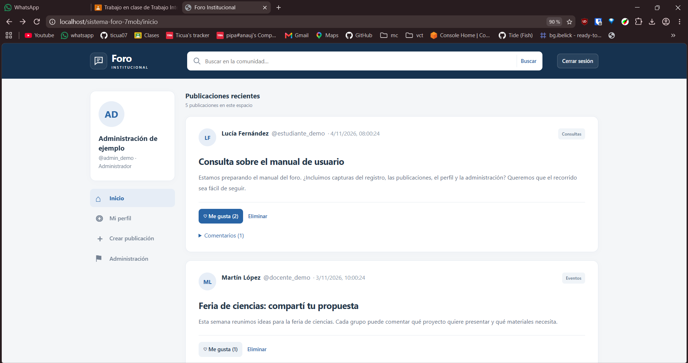
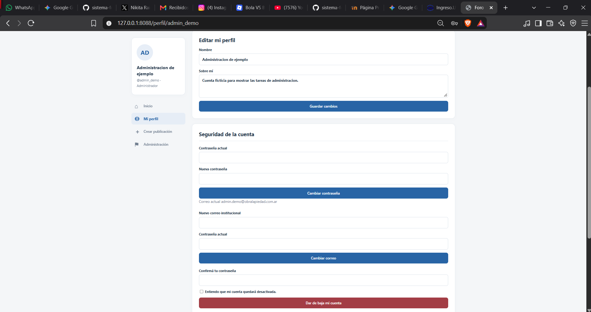
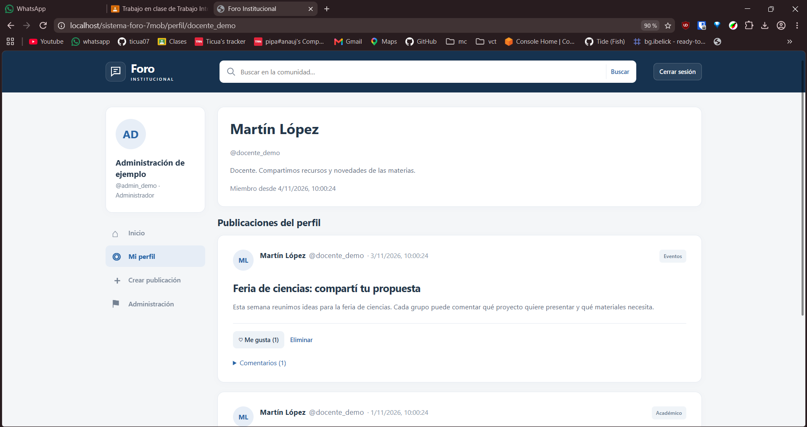
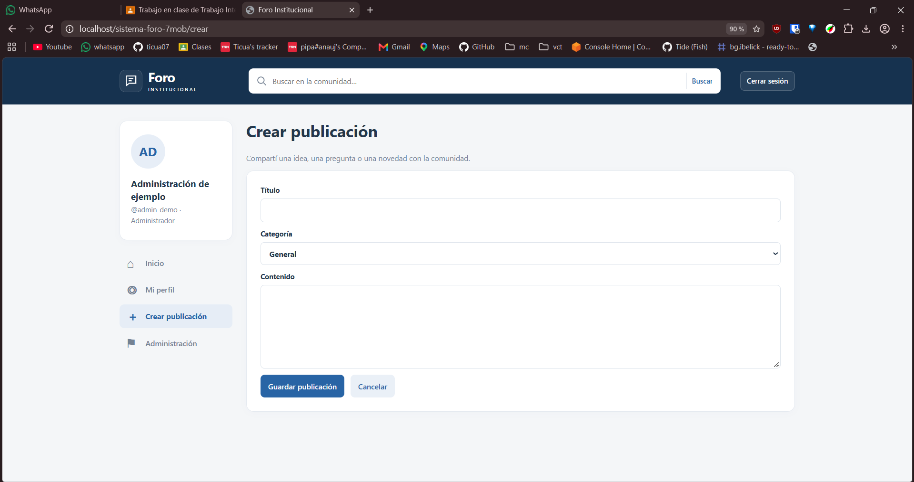
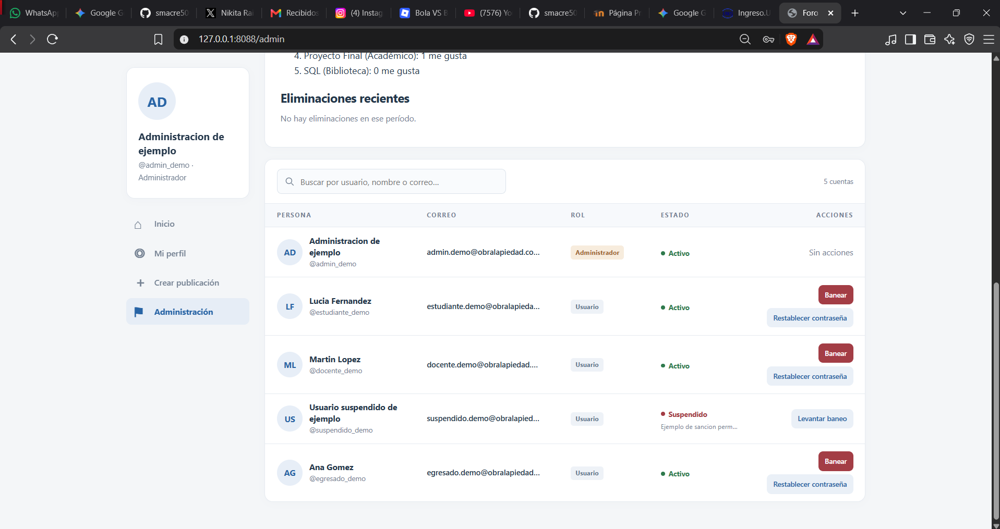
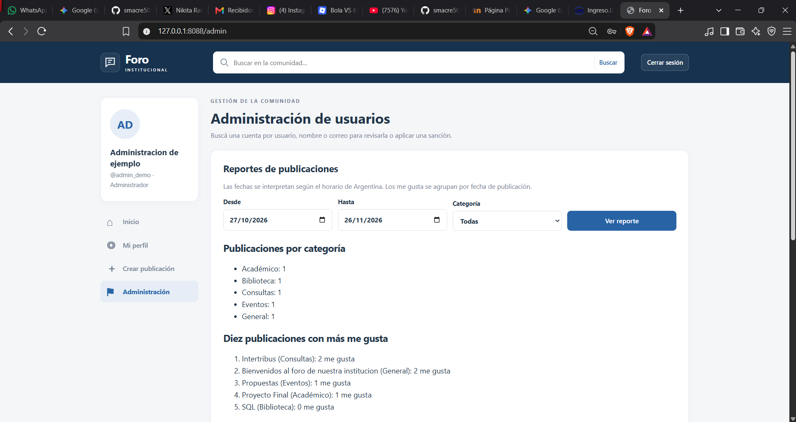

# sistema-foro-7moB
# Pasos para la instalación inicial

1. Colocar el proyecto dentro de la carpeta htdocs de xampp
2. Comprobar que esté `LoadModule rewrite_module modules/mod_rewrite.so` activa en httpd.conf y que el bloque de `<Directory "C:/xampp/htdocs">` tenga `AllowOverride All` (si se modifica el archivo hay que reiniciar apache).
3. Ejecutar `db/foro.sql` para crear la base de datos limpia.
	1. OPCIONAL: Ejecutar `db/insert.sql` para cargar datos de prueba
4. Revisar que los datos de conexión en `backend/conn.php` coincidan con los de la base de datos MySQL de Xampp
5. Listo. Abrir el foro yendo a `localhost:puerto/sistema-foro-7mob/inicio`

# Vistas

La página web cuenta con 4 vistas, diferenciadas en secciones.

## Inicio
Carga los posts generales, no necesita autenticación para verse.

Esta página es reutilizada cuando el usuario busca posts (`?buscar=`).

## Mi perfil/Perfil

Muestra el perfil del usuario y sus posts. Tambien muestra un formulario para editar los datos si el perfil es el mismo que el del usuario logeado.

Muestra como se puede editar el perfil del usuario

Perfil de otra persona:

## Crear publicación

Formulario para crear una publicación.

## Administración

Pagina administración de usuarios, restablecer contraseñas, permite buscar y suspender o levantar suspensiones de usuarios.

Esta página solo esta disponible para administradores (Rol administrador)

# Estructura de archivos

- `frontend/`: Incluye todo el frontend con unas reglas usando .htaccess para remover el .php de las páginas para que quede mejor.
- `db/`: Incluye 2 archivos de base de datos, `foro.sql` es el archivo con solo las tablas y relaciones que se usaria en la base de datos y `insert.sql` tiene datos falsos para probar la página web
- `backend/`: Api hecha con PHP, cada archivo es un endpoint diferente
